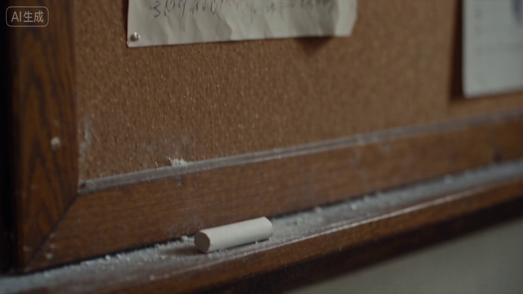
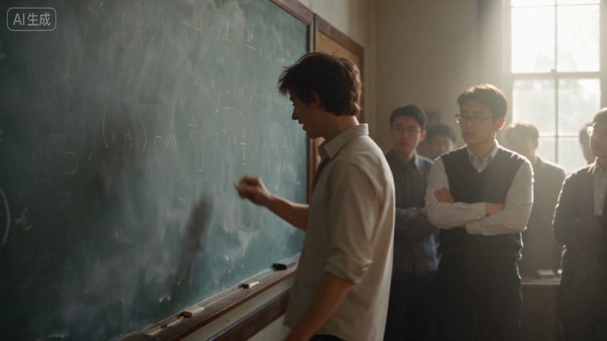
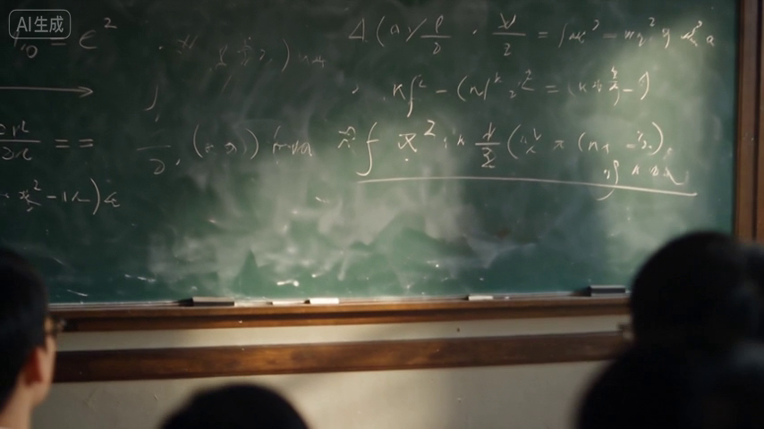

# 完整案例：费曼《不一样的工具箱》

这是用本技能从零做出来的一套真实短剧，涵盖**文 → 资 → 视 → 剪**全流程，附全部中间产物（5 集剧本、资产图、每集存档版分镜 + 纯提示词、成片抽帧）。

**题材**：5 集 × 15 秒，16:9。1930 年代末普林斯顿，数学系用围道积分、级数展开都攻不破的一道积分 ∫₀^∞ sin x / x dx，被物理系的年轻费曼用「积分号下对参数求导」当场解开。取材自费曼自传《别逗了，费曼先生！》「A Different Box of Tools」章，台词为史实情境的中文化戏剧改写。

**五集结构**（单场景、同一道题贯穿）：

| 集 | 标题 | 弧线 | 钩子 |
|---|---|---|---|
| E01 | 无人能解的积分 | 难题摆着 → 物理系被奚落 → 费曼走向黑板 | "物理系的？"激将 |
| E02 | 只有一把工具 | 标准方法轮番登场 → 双双碰壁 → "借一把我的" | 换工具的悬念 |
| E03 | 积分号下求导 | 全场质疑 → 参数求导化简 → π/2 跃然板上 | 打脸时刻 |
| E04 | 不一样的工具箱 | 被追问方法 → 坦白工具箱不同 → 点题金句 | "跟你们不一样" |
| E05 | 换把工具，再看那道题 | 人群不散 → "一把锤子"提醒 → 对手重新望向黑板 | 升华留钩 |

---

## 成片效果（抽帧展示）

成片 mp4 体积较大，**不随本仓库分发**。这里用 `成片抽帧/` 里的关键帧展示画面效果。

**① 黄金三秒 + 激将（E01）** —— 揉皱的草稿纸砸在公告板前，积分题被反复划掉：



**② 角色与口型（E01）** —— 费曼浅色衬衫、卷发，走向黑板时嘴部清晰、正在说话，黑板演算入画：


**③ 标准方法碰壁（E02）** —— 费曼在黑板前书写推导：



**④ 破题时刻（E03）** —— 侧脸、手握粉笔、积分号下求导的推导铺在黑板上，皮肤毛孔与胶片颗粒可见：


**⑤ 点题金句（E04）** —— 解题后被围住追问，费曼坦白"工具箱不一样"：


**⑥ 全片收尾（E05）** —— 镜头后拉退到整块黑板，满板推导与最初那道积分式并排留着：



| 项 | 值 |
|---|---|
| 时长 / 帧率 | 15.07 秒 / 60fps（全片拼接 75.4 秒） |
| 分辨率 | 854 × 480（480p） |
| 音轨 | AAC 双声道，mean 音量约 −21 ~ −25 dB（含原生生成的对白语音，非全哑） |
| 模型 / 模式 | Seedance 2.5 Flash / m2v（挂 3 张参考图） |

> 画面左上角的"AI生成"角标是即梦平台自动加的，提示词里写了"无水印"也无法去除，属平台行为。

---

## 一步一步看产物

### 阶段一：文（剧本）

`剧本_费曼.md` — 5 集完整剧本。核心梗：一道攻不破的积分 / 一个被奚落的物理系年轻人 / 一次换工具的反杀。含人物小传、五回合大纲、逐集剧本正文（黄金三秒、逐字对白、每集钩子一览）。

### 阶段二：资（资产图）

`资产提示词.md` — 单场景精简资产：主角费曼（正面 + 四视图）、对手博士生、普林斯顿教室（正打 / 反打 / 侧面全景）、粉笔与公告板积分题两件道具。

`资产图/` — 实际出图的 3 张（C01 费曼、C02 博士生、S01 教室正打，Seedream 5.5 / 2K），附对应纯提示词 `.txt`。`asset_ids.txt` 记录 nodeId / resourceId 与五集成片的 resourceId。

**这一步的作用**：先把人物长相、服装、场景光位固定下来。后面生成视频时把这些图挂成参考，人物才不会每集换脸。本案例五集共用同三张参考图，抽帧核对无换脸。

### 阶段三：视（视频）

每集两份文件，**对照着看**：

- `E0X_分镜提示词.md` — **给人看的存档版**，开头带标题、生成配置、弧线、台词表、检查记录、尾帧描述等文档头，正文是叙事版分镜提示词。写法特点：
  - 一句弧线立住故事（从…到…最后…）
  - 整体画面、人物与空间用流畅散文写，站位距离光位自然带出，**不贴轴线/机位理由/负空间/因果链这类术语标签**
  - 【镜头与时间轴】`[00.0-xx.xs]` 分段，每段是小说般的短句，动作有接触与停顿
  - 台词只在角色说话那一刻写一次；【声音】是一整段随画面变化的散文，写明同期声 + 口型同步，**不把台词再抄一遍、不拆成对白/动作音/环境声四行**
  - 参考图用途写在文档头，不写进正文
- `E0X_prompt.txt` — **给模型用的纯提示词版**，只含正文（从"生成一段…"开始），没有任何 `# 标题`/配置/说明/分隔线，也没有【参考】段。**调用 CLI 时 `--prompt "$(cat E0X_prompt.txt)"` 用的就是这个文件**，不是上面那个 .md。

存档版正文与纯提示词正文逐集核对一致。

### 阶段四：剪（成片）

五段 15 秒成片用 ffmpeg 无损拼接（`-c copy`）成 75.4 秒全片：

```bash
# concat 文件必须用绝对路径
printf "file 'D:/.../费曼项目/E0%d_成片.mp4'\n" 1 2 3 4 5 > concat_list.txt
ffmpeg -f concat -safe 0 -i concat_list.txt -c copy 费曼_全片.mp4
```

---

## 这次案例中验证过的经验（重点）

### 1. 必须先出资产图，再 m2v 挂参考图

直接用文生视频（t2v）不挂参考图，15 秒里多镜头、两角色反复切正反打，**必然跨镜换脸**。正确做法：先出资产图，再用 **m2v 挂 3 张参考图**（费曼正面 + 博士生正面 + 教室正打）。本案例抽帧核对无换脸。

另有一个实测硬点：**m2v 模式不带参考图，`node create video` 会直接报错**（mode m2v has no references）。必须先出图拿到 resourceId 再建视频节点，不能像 t2v 那样先建节点。

### 2. 给模型 cat 纯提示词，别 cat 带文档头的 .md

若用 `--prompt "$(cat E0X_分镜提示词.md)"`，那些 `# 标题`/生成配置/台词表/检查记录等**给人看的文档头**会被原样喂给模型，是干扰画面的噪音。正确做法：正文单独存 `.txt`，CLI 只 cat 它。本目录每集都同时提供两个版本对照，SKILL.md 已把这条写成硬规则。

### 3. 对白必须逐字写进【声音】段，不能只写"生成音效"

Seedance 原生生成对白语音 + 口型，台词要写在角色说话那一刻的正文里，并在【声音】段统一声明"同期开口、口型同步"。本案例每集都有人物同期对白（画外音也声明口型），实测音轨非全哑、mean 约 −21dB 属正常对白电平。

### 4. 人物资产提示词要写明族裔/面孔特征（本案例的不足）

本案例的博士生资产提示词只写了"深色短发、戴眼镜"，**没写族裔**，结果生成成了东亚面孔；而费曼是高加索面孔，在 1930 年代普林斯顿的场景里反差明显，削弱了史实氛围。这是成片后抽帧才发现的。

**教训**：角色资产提示词凡是涉及特定时代/地域的写实题材，应明确写清面孔/族裔特征（如"高加索面孔"），否则模型会按自己的默认分布生成。本案例为了五集人物统一，未重出资产，保留此不足作为反面参考。

### 5. 480p 性价比高，报价就是实扣

- 480p / 15 秒：**105 积分**；720p / 15 秒：约 285 积分。
- `node quote` 返回的 `maxCredits` 就是实际扣费。本案例两次核对余额差值分毫不差：三张图 18 分、五集视频 525 分。

---

## 复现流程（即梦 CLI）

```bash
# 1. 建项目画布
dreamina-canvas canvas create "不一样的工具箱-费曼" --use

# 2. 出资产图（seedream_5.5，草稿→报价→确认→运行→等待→下载）
dreamina-canvas node create image --model seedream_5.5 --mode t2i \
  --ratio 9:16 --resolution 2K --count 1 --prompt "$(cat 资产图/C01_费曼.txt)"
dreamina-canvas node quote --node-id <id> ...          # 免费报价
dreamina-canvas node confirm --node-id <id> --credit-ceiling 18
dreamina-canvas node run --node-id <id> --credit-token <token>
dreamina-canvas operation wait <submitId>
dreamina-canvas resource download <resourceId> -o 资产图/C01_费曼.png

# 3. 生成视频（m2v 挂 3 张参考图，480p）
dreamina-canvas node create video --model seedance_2.5_flash --mode m2v \
  --ratio 16:9 --resolution 480p --duration 15 --count 1 \
  --ref res:<费曼resourceId> --ref res:<博士生resourceId> --ref res:<教室resourceId> \
  --prompt "$(cat E01_prompt.txt)"   # 注意：cat 纯提示词，不要 cat 带文档头的 .md
# 草稿 → quote → confirm 拿 token → run → operation wait → download
```

完整的报价、确认、运行、等待命令见根目录 README 和 `SKILL.md`。
